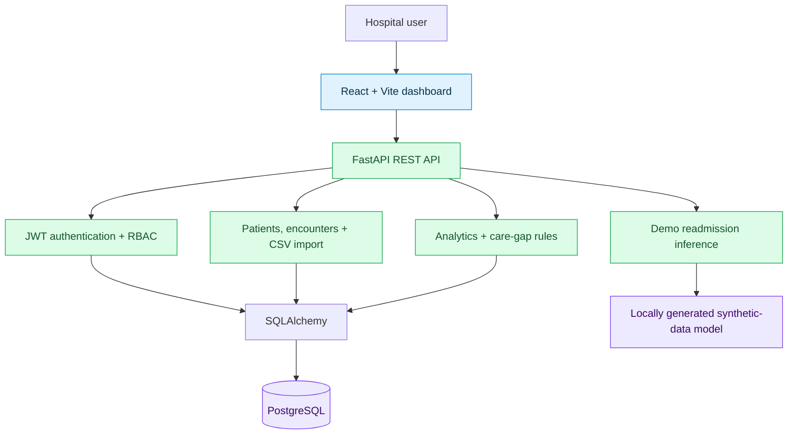

🩺 CareGap-AI
AI-Powered Healthcare Analytics & Care Gap Detection
From fragmented encounter data to actionable operational insights.

A full-stack healthcare intelligence MVP built with FastAPI · React · PostgreSQL · Scikit-learn.

Overview · Features · Architecture · Quick Start · API · Limitations

[!IMPORTANT]
Portfolio demonstration — not a clinical decision-support product. The readmission-risk model uses synthetic data, has not been clinically validated, and must not be used for diagnosis, treatment, triage, or other clinical decisions.

Overview
CareGap-AI is an end-to-end healthcare analytics prototype for managing organizational patient and encounter data, importing clinical records, reviewing operational metrics, and identifying possible care gaps using explicit rules. It also demonstrates how a machine-learning inference service can be integrated into a production-style web application.

The emphasis is on full-stack engineering, modular APIs, database design, authorization, automated testing, and responsible AI integration—not on claiming clinical accuracy.
At a glance
Area	Implementation
Application	React dashboard + FastAPI REST API
Persistence	PostgreSQL, SQLAlchemy, Alembic
Security	JWT authentication, organization-scoped access, RBAC
Data workflow	CSV encounter import, validation, import tracking
Insights	Clinical overview metrics and care-gap flags
ML demonstration	Synthetic-data logistic regression and inference endpoint
Verification	159 backend tests passed; frontend production build successful
Stage	Functional MVP / portfolio project

Product walkthrough
The intended demo flow is:

Sign in → Select an organization → Review dashboard → Add a patient → Import encounters → Inspect care gaps → Run demo readmission prediction
Screenshots
Screenshots will be added after capturing the running application. Avoid showing real patient information, passwords, or access tokens.

Dashboard	Care gap detection
Screenshot coming soon	Screenshot coming soon
Patient management	Readmission risk demo
Screenshot coming soon	Screenshot coming soon

Core capabilities
<table>
<tr><td width="50%" valign="top">

🔐 Identity & access
- User registration and login
- JWT-based authentication
- Organization creation and membership management
- Role-based authorization
- Audit logging for supported operations
</td><td width="50%" valign="top">

🧑‍⚕️ Patient & encounter records
- Create, retrieve, and update patients
- Browse organization-scoped encounters
- Structured request and response validation
- Protected data access through REST APIs
</td></tr>
<tr><td valign="top">

📥 Clinical data ingestion
- CSV-based encounter import
- Input validation and normalization
- Import-job tracking
- Sample encounter dataset
</td><td valign="top">

📊 Analytics dashboard
- Encounter and import overview
- Validation and review metrics
- Length-of-stay summaries
- React-based visualizations
</td></tr>
<tr><td valign="top">

🔎 Rule-based care gaps
- Missing admission or discharge information
- Required follow-up not scheduled
- Records pending review
- Rule identifiers and severity labels
</td><td valign="top">

🤖 Experimental ML inference
- Synthetic training data generation
- Feature engineering and validation
- Logistic regression training
- Serialized model and FastAPI inference
- Frontend risk demonstration
</td></tr>
</table>

System architecture

The codebase separates API routes, validation schemas, domain models, business services, and ML utilities, with Alembic handling database migrations.
Technology stack
Layer	Tools
Frontend	React, Vite, JavaScript, Tailwind CSS
Backend	Python, FastAPI, Pydantic
Database	PostgreSQL, SQLAlchemy
Migrations	Alembic
Authentication	JWT; organization-scoped RBAC
Machine learning	Scikit-learn, logistic regression
Testing	Pytest
Developer tooling	Git, GitHub, Swagger UI / OpenAPI

Repository structure
CareGap-AI/
├── backend/
│   ├── app/
│   │   ├── api/          # HTTP endpoints
│   │   ├── core/         # Configuration, auth, permissions
│   │   ├── db/           # Database session
│   │   ├── ml/           # Training and inference utilities
│   │   ├── models/       # SQLAlchemy entities
│   │   ├── schemas/      # API validation contracts
│   │   ├── services/     # Domain and analytics logic
│   │   └── main.py       # FastAPI entry point
│   └── tests/            # Backend test suite
├── frontend/
│   ├── public/
│   ├── src/
│   └── package.json
├── migrations/           # Alembic revisions
├── docs/                 # Technical documentation
├── sample_encounters.csv
├── alembic.ini
├── requirements.txt
└── README.md
Getting started
Prerequisites
- Python with pip
- Node.js with npm
- PostgreSQL
- Git
1. Clone
git clone https://github.com/EmanZahid1644/CareGap-AI.git
cd CareGap-AI
2. Set up the backend
Windows (Command Prompt):
python -m venv .venv
.venv\Scripts\activate
pip install -r requirements.txt
macOS / Linux:
python3 -m venv .venv
source .venv/bin/activate
pip install -r requirements.txt
Database configuration: Create a local PostgreSQL database and supply the environment variables required by [`backend/app/core/config.py`](backend/app/core/config.py). Use locally generated secrets. Do not commit .env files or credentials.

Apply migrations from the repository root:
python -m alembic upgrade head
Start the API:
python -m uvicorn backend.app.main:app --reload
Service	Local URL
API	http://127.0.0.1:8000
Swagger UI	http://127.0.0.1:8000/docs
OpenAPI schema	http://127.0.0.1:8000/openapi.json

[!NOTE]
Environment-variable names and database credentials depend on your local configuration. Refer to the repository's configuration code and [setup documentation](docs/09_SETUP_AND_DEPLOYMENT.md) before running the backend.

3. Start the frontend
In a second terminal:
cd frontend
npm install
npm run dev
Open http://localhost:5173.

Build the frontend for production:
npm run build
4. Train the demonstration model
The generated .joblib model is intentionally excluded from Git. From the repository root:
python -m backend.app.ml.train_demo_model
This produces a demonstration model trained on synthetic data. It is not a clinically validated prediction system.
API reference
All application endpoints below are prefixed with /api/v1. Organization-specific endpoints require an appropriate authenticated user and organization permissions.
Capability	Method	Endpoint
Register	POST	/auth/register
Login	POST	/auth/login
Current user	GET	/auth/me
Organizations	GET / POST	/organizations
Memberships	GET / POST	/organizations/{organization_id}/members
Patients	GET / POST	/organizations/{organization_id}/patients
Encounters	GET	/organizations/{organization_id}/encounters
Import encounters	POST	/organizations/{organization_id}/imports/encounters
Analytics overview	GET	/organizations/{organization_id}/analytics/overview
Care-gap detection	GET	/organizations/{organization_id}/care-gaps/encounters
Demo readmission risk	POST	/organizations/{organization_id}/analytics/readmission-risk

For request bodies, authentication requirements, and the complete endpoint list, use Swagger UI while the backend is running.
Testing & quality
Run backend tests from the repository root:
python -m pytest backend/tests -q
Latest locally verified result:
159 passed in 3.41s
Frontend: npm run build completed successfully. The bundler reported a non-blocking large-chunk size warning; code splitting remains a potential optimization.

The test suite covers authentication, permissions, organizations, memberships, patients, encounters, CSV imports, analytics, audit logging, and database behavior. Passing software tests does not establish clinical validity or regulatory compliance.
Responsible AI & limitations
[!CAUTION]
CareGap-AI is a technical MVP. Do not use it with real patient data or for real clinical decisions without the necessary security, privacy, governance, clinical validation, and regulatory review.

- Synthetic model: Readmission risk scores are illustrative, not medically actionable.
- Rule-based gaps: Detection depends on available structured fields; missing data can limit results.
- Incomplete workflows: Full care-gap review, assignment, and resolution tracking are not yet implemented.
- Production readiness: Security hardening, monitoring, deployment, and compliance assessment remain future work.
- Privacy: Use fictional or appropriately authorized test data for demonstrations.
Roadmap
Priority	Planned enhancement
Next	Care-gap review and resolution workflow
Next	Improved dashboard and screenshot documentation
Next	CI pipeline for tests and frontend builds
Later	Monitoring, deployment, and operational hardening
Later	Expanded care-gap rules and reporting
Research	Governed datasets, model evaluation, explainability

Technical documentation
Document	Description
[Product requirements](docs/01_PRODUCT_REQUIREMENTS.md)	Product goals and scope
[System architecture](docs/02_SYSTEM_ARCHITECTURE.md)	Components and architectural decisions
[Database design](docs/03_DATABASE_DESIGN.md)	Data model and persistence
[API specification](docs/04_API_SPECIFICATION.md)	API design
[AI / ML design](docs/05_AI_ML_DESIGN.md)	Model approach and constraints
[Security & privacy](docs/06_SECURITY_AND_PRIVACY.md)	Security considerations
[Testing strategy](docs/07_TESTING_STRATEGY.md)	Verification approach
[Development roadmap](docs/08_DEVELOPMENT_ROADMAP.md)	Delivery phases
[Setup & deployment](docs/09_SETUP_AND_DEPLOYMENT.md)	Environment guidance
[MVP decisions](docs/10_PRODUCT_EVOLUTION_AND_MVP_DECISION.md)	Scope evolution

Built to demonstrate applied AI + full-stack engineering
FastAPI · React · PostgreSQL · ML integration · RBAC · Automated testing

Repository: github.com/EmanZahid1644/CareGap-AI

License: No open-source license is currently assigned. All rights reserved unless a license is added.

