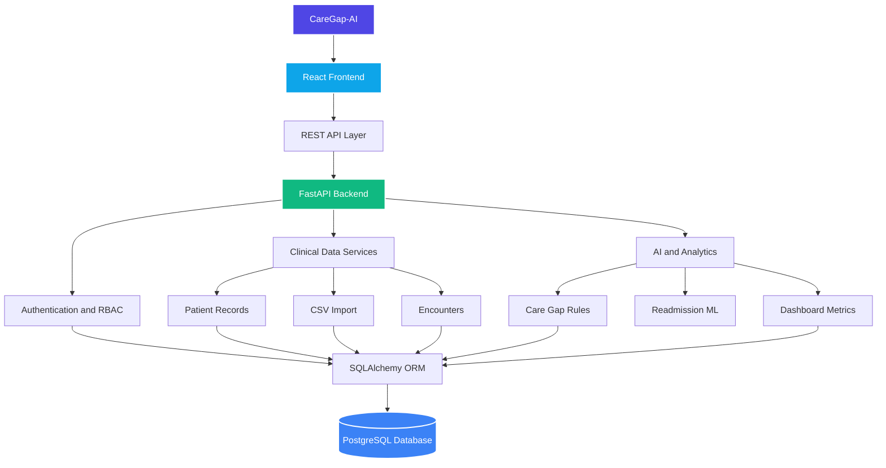

🩺 CareGap-AI
🤖 AI-Powered Healthcare Analytics & Care Gap Detection Platform
CareGap-AI is a full-stack healthcare intelligence MVP designed to help healthcare organizations manage patient records, analyze clinical encounters, identify potential gaps in care, and explore AI-powered hospital analytics. 🏥📊

The platform combines a FastAPI backend, React dashboard, PostgreSQL database, role-based access control, and a demonstration machine learning model into a modular, testable system. ⚙️💡
📌 Project status: Functional MVP / Portfolio Demonstration
⚠️ AI disclaimer: The current readmission risk model is trained on synthetic data. It is intended for technical demonstration only and must not be used for clinical decisions.

🌟 Key Features
1. 🔐 Authentication & Organization Management
- User registration and JWT-based authentication
- Organization creation and management
- Role-based access control (RBAC)
- Organization membership management
- Protected API endpoints
- Audit logging for supported operations
2. 🗂️ Patient & Encounter Management
- Create and retrieve patient records
- Update patient information
- Manage clinical encounter records
- Organization-scoped data access
- Structured data validation
3. 📥 Clinical Data Import
- CSV-based encounter import
- Data validation and normalization
- Import job tracking
- Encounter retrieval and filtering
- Sample encounter dataset for demonstration
4. 📈 Clinical Analytics Dashboard
- Hospital encounter overview
- Import and validation metrics
- Length-of-stay analytics
- Data visualization and reporting
- Interactive React dashboard
5. 🔍 Rule-Based Care Gap Detection
The care gap detection engine evaluates available encounter information and identifies potential issues such as:
- 🚫 Missing discharge information
- 🗓️ Required follow-up appointments not scheduled
- 📋 Records pending data review
- 📥 Missing admission information
Each detected issue can be represented with a rule identifier and severity level.
6. 🤖 AI-Powered Readmission Risk Demonstration
CareGap-AI includes an experimental machine learning pipeline for readmission risk estimation.

Current implementation:
- 🧪 Synthetic dataset generation
- 🔧 Feature preparation and validation
- 📊 Logistic regression model training
- 📦 Model serialization
- ⚡ FastAPI inference endpoint
- 💻 Frontend risk prediction interface
Important: The model is not clinically validated and does not provide medical advice, diagnosis, or treatment recommendations.

🛠️ Technology Stack
Layer	Technologies	
Frontend	React, Vite, JavaScript, Tailwind CSS	💻
Backend	Python, FastAPI, Pydantic	⚡
Database	PostgreSQL	🐘
ORM	SQLAlchemy	🔗
Database migrations	Alembic	🔄
Authentication	JWT	🔑
Machine Learning	Scikit-learn, Logistic Regression	📊
Testing	Pytest	🧪
API Documentation	OpenAPI / Swagger UI	📄
Version Control	Git, GitHub	🐙

🏗️ System Architecture

The backend follows a modular architecture with separate API routes, database models, schemas, services, and machine learning components.
📁 Project Structure
CareGap-AI/
│
├── backend/
│   ├── app/
│   │   ├── api/
│   │   ├── core/
│   │   ├── db/
│   │   ├── ml/
│   │   ├── models/
│   │   ├── schemas/
│   │   ├── services/
│   │   └── main.py
│   └── tests/
│
├── frontend/
│   ├── public/
│   ├── src/
│   ├── package.json
│   └── vite.config.js
│
├── migrations/
├── docs/
├── alembic.ini
├── requirements.txt
├── sample_encounters.csv
└── README.md
🚀 Getting Started
📋 Prerequisites
- Python and pip 🐍
- Node.js and npm 📦
- PostgreSQL 🐘
- Git 🐙
1️⃣ Clone the Repository
git clone https://github.com/EmanZahid1644/CareGap-AI.git
cd CareGap-AI
2️⃣ Backend Setup
Create a virtual environment:
python -m venv .venv
Activate it on Windows:
.venv\Scripts\activate
On macOS/Linux, use source .venv/bin/activate.

Install dependencies:
pip install -r requirements.txt
Configure your local PostgreSQL database and the environment variables required by backend/app/core/config.py. ⚙️🔒 Do not commit real database credentials, JWT secrets, or private configuration files.

Run database migrations:
python -m alembic upgrade head
Start the backend:
python -m uvicorn backend.app.main:app --reload
- 🌐 Backend URL: http://127.0.0.1:8000
- 📚 Interactive API documentation: http://127.0.0.1:8000/docs
3️⃣ Frontend Setup
Open another terminal window or tab:
cd frontend
npm install
npm run dev
💻 Frontend URL: http://localhost:5173

For a production build:
npm run build
4️⃣ Run Backend Tests
From the project root:
python -m pytest backend/tests -q
✅ Latest verified result: 159 tests passed.

Tests require an appropriately configured test environment and PostgreSQL test database.
5️⃣ Generate the Demonstration ML Model
The generated model artifact is excluded from Git version control. Run the local training script:
python -m backend.app.ml.train_demo_model
The resulting model is used for demonstration inference. 🤖
🔌 API Overview
CareGap-AI exposes REST APIs under /api/v1. 🛠️
Module	Example endpoints
🔑 Authentication	/auth/register, /auth/login, /auth/me
🏢 Organizations	/organizations
👥 Members	/organizations/{organization_id}/members
🧑‍⚕️ Patients	/organizations/{organization_id}/patients
🏥 Encounters	/organizations/{organization_id}/encounters
📥 Imports	/organizations/{organization_id}/imports/encounters
📊 Analytics	/organizations/{organization_id}/analytics/overview
🔍 Care gaps	/organizations/{organization_id}/care-gaps/encounters
🤖 AI inference	/organizations/{organization_id}/analytics/readmission-risk

Full interactive API documentation is available through Swagger UI. 📄
🧪 Testing & Validation
The project includes automated tests covering major backend modules, including:
- 🔑 Authentication
- 🛡️ Authorization and permissions
- 🏢 Organization management
- 👥 Membership roles
- 🧑‍⚕️ Patient management
- 🏥 Clinical encounters
- 📥 CSV import
- 📊 Clinical analytics
- 📝 Audit logging
- 🐘 Database operations
- ✅ Current backend test status: 159 passed.
- ✨ Frontend production build: Successful.
These results validate the tested software behaviors, not clinical accuracy or production security certification.
⚠️ Current Limitations
CareGap-AI is an MVP and technical demonstration, not a certified clinical system.
- 🧪 The machine learning model uses synthetic training data.
- 📋 Readmission predictions have not been clinically validated.
- 🔍 Care gap detection currently relies on predefined rules and available structured fields.
- 🚧 Some advanced clinical workflows, including full care-gap resolution tracking, are not yet implemented.
- 🛡️ Production deployment, security hardening, compliance assessment, and operational monitoring require additional work.
- 🛑 The platform must not be used with real patient data without appropriate privacy, security, and regulatory safeguards.
🔮 Future Enhancements
- ➕ Expanded care gap detection rules
- 🔄 Care gap review and resolution workflows
- 📈 Advanced hospital reporting
- 🎯 Improved model evaluation using appropriately governed datasets
- 👁️ Model monitoring and explainability
- 🚀 Production deployment and CI/CD
- ⚙️ Additional organization administration features
- 🌐 Expanded patient engagement capabilities
📚 Documentation
Detailed technical documentation is available in the [`docs/`](docs/) directory, including:
- 📄 Product requirements
- 🏗️ System architecture
- 🐘 Database design
- 🔌 API specification
- 🤖 AI/ML design
- 🔒 Security and privacy
- 🧪 Testing strategy
- 🗺️ Development roadmap
- ⚙️ Setup and deployment
🎯 Project Purpose
CareGap-AI demonstrates practical experience in:

Backend Engineering · Applied AI/ML · REST API Development · Database Design · Healthcare Analytics · Full-Stack Development · Automated Testing

The project emphasizes modular architecture, organization-scoped data access, testable services, and responsible presentation of experimental AI capabilities. 🌟
⚖️ License
No open-source license has been assigned yet. All rights are reserved unless a license is added to the repository. 📝