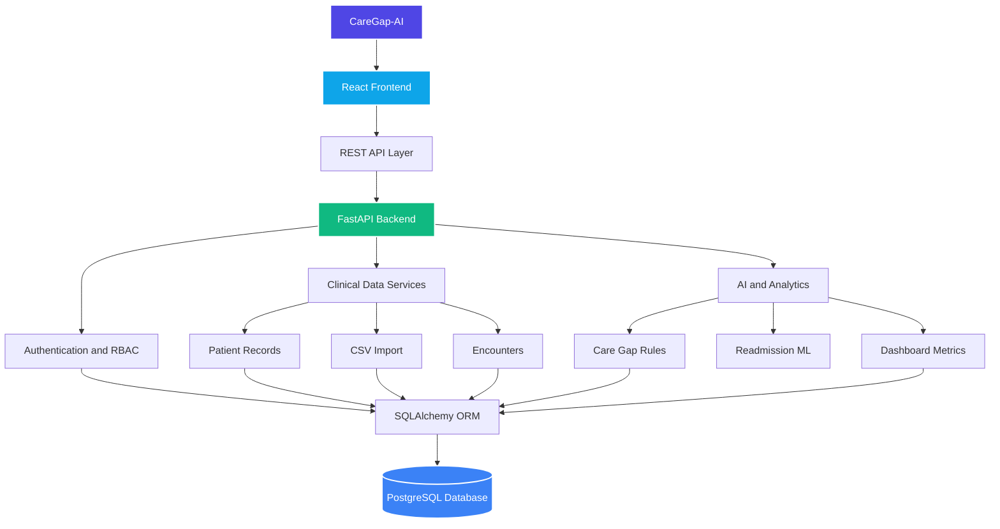

# 🩺 CareGap-AI

> **AI-Powered Healthcare Analytics & Care Gap Detection Platform**

CareGap-AI is a full-stack healthcare intelligence MVP designed to help healthcare organizations manage patient records, analyze clinical encounters, identify potential gaps in care, and explore AI-powered hospital analytics. 🏥📊

The platform combines a FastAPI backend, React dashboard, PostgreSQL database, role-based access control, and a demonstration machine learning model into a modular, testable system. ⚙️💡

📌 **Project Status:** Functional MVP / Portfolio Demonstration

⚠️ **AI Disclaimer:** The current readmission risk model is trained on synthetic data. It is intended for technical demonstration only and **must not be used for clinical decisions**.

## 🌟 Key Features

### 1. 🔐 Authentication & Organization Management

- User registration and JWT-based authentication.
- Organization creation, management, and membership workflows.
- Role-based access control (RBAC) and protected API endpoints.
- Comprehensive audit logging for supported operations.

### 2. 🗂️ Patient & Encounter Management

- Create, retrieve, and update patient records.
- Manage detailed clinical encounter records.
- Organization-scoped data access and structured data validation.

### 3. 📥 Clinical Data Import

- CSV-based encounter import with validation and data normalization.
- Import job tracking and encounter retrieval/filtering.
- Sample encounter dataset provided for rapid onboarding and demonstration.

### 4. 📈 Clinical Analytics Dashboard

- Interactive React dashboard for hospital encounter overviews.
- Metrics on length-of-stay (LOS), imports, and validation status.
- Data visualization and structured reporting.

### 5. 🔍 Rule-Based Care Gap Detection

The care gap detection engine evaluates encounter information to identify critical issues:

- 🚫 Missing discharge information
- 🗓️ Unscheduled required follow-up appointments
- 📋 Records pending data review
- 📥 Missing admission details

*Each detected issue is mapped to a specific rule identifier and assigned a severity level.*

### 6. 🤖 AI-Powered Readmission Risk Demonstration

Includes an experimental machine learning pipeline for readmission risk estimation:

- 🧪 Synthetic dataset generation.
- 🔧 Feature engineering and data validation.
- 📊 Logistic regression model training and serialization.
- ⚡ FastAPI inference endpoints & interactive frontend interface.

> **Important:** The model is not clinically validated and does not provide medical advice, diagnosis, or treatment recommendations.

## 🛠️ Technology Stack

| Layer | Technologies |
| --- | --- |
| **Frontend** | React, Vite, JavaScript, Tailwind CSS 💻 |
| **Backend** | Python, FastAPI, Pydantic ⚡ |
| **Database** | PostgreSQL 🐘 |
| **ORM** | SQLAlchemy 🔗 |
| **Migrations** | Alembic 🔄 |
| **Authentication** | JWT (JSON Web Tokens) 🔑 |
| **Machine Learning** | Scikit-learn, Logistic Regression 📊 |
| **Testing** | Pytest 🧪 |
| **API Docs** | OpenAPI / Swagger UI 📄 |
| **Version Control** | Git, GitHub 🐙 |

## 🏗️ System Architecture



*The backend follows a modular architecture separating API routes, database models, Pydantic schemas, domain services, and ML components.*

## 📁 Project Structure

```text
CareGap-AI/
│
├── backend/
│   ├── app/
│   │   ├── api/          # REST API endpoints & routers
│   │   ├── core/         # Core config, security & auth settings
│   │   ├── db/           # Database sessions & initialization
│   │   ├── ml/           # Machine learning models & training scripts
│   │   ├── models/       # SQLAlchemy database models
│   │   ├── schemas/      # Pydantic models for validation
│   │   ├── services/     # Business logic & domain services
│   │   └── main.py       # FastAPI application entry point
│   └── tests/            # Pytest suite
│
├── frontend/
│   ├── public/           # Static assets
│   ├── src/              # React components & UI logic
│   ├── package.json
│   └── vite.config.js
│
├── migrations/           # Alembic migration scripts
├── docs/                 # Detailed documentation
├── alembic.ini
├── requirements.txt
├── sample_encounters.csv
└── README.md
```

## 🚀 Getting Started

### 📋 Prerequisites

- Python 3.9+ & `pip` 🐍
- Node.js & `npm` 📦
- PostgreSQL 🐘
- Git 🐙

### 1️⃣ Clone the Repository

```bash
git clone https://github.com/EmanZahid1644/CareGap-AI.git
cd CareGap-AI
```

### 2️⃣ Backend Setup

Create and activate a virtual environment:

- **Windows:**

  ```bat
  python -m venv .venv
  .venv\Scripts\activate
  ```

- **macOS/Linux:**

  ```bash
  python3 -m venv .venv
  source .venv/bin/activate
  ```

Install backend dependencies:

```bash
pip install -r requirements.txt
```

Configure your local PostgreSQL database and set up environment variables required by `backend/app/core/config.py`.

> ⚙️🔒 *Do not commit real database credentials, JWT secrets, or private configuration files.*

Run database migrations:

```bash
python -m alembic upgrade head
```

Start the API backend:

```bash
python -m uvicorn backend.app.main:app --reload
```

- 🌐 **Backend Base URL:** `http://127.0.0.1:8000`
- 📚 **Swagger UI Docs:** `http://127.0.0.1:8000/docs`

### 3️⃣ Frontend Setup

In a new terminal window:

```bash
cd frontend
npm install
npm run dev
```

- 💻 **Frontend URL:** `http://localhost:5173`

To create a production build:

```bash
npm run build
```

### 4️⃣ Run Backend Tests

From the project root:

```bash
python -m pytest backend/tests -q
```

✅ **Latest Verified Result:** 159 tests passed.

*(Note: Tests require an appropriately configured test environment and PostgreSQL database.)*

### 5️⃣ Generate the Demonstration ML Model

The trained model artifact is excluded from version control. Run the training script locally to generate it:

```bash
python -m backend.app.ml.train_demo_model
```

## 🔌 API Overview

CareGap-AI exposes REST APIs scoped under `/api/v1`:

| Module | Key Endpoints |
| --- | --- |
| 🔑 **Authentication** | `/auth/register`, `/auth/login`, `/auth/me` |
| 🏢 **Organizations** | `/organizations` |
| 👥 **Members** | `/organizations/{organization_id}/members` |
| 🧑‍⚕️ **Patients** | `/organizations/{organization_id}/patients` |
| 🏥 **Encounters** | `/organizations/{organization_id}/encounters` |
| 📥 **Imports** | `/organizations/{organization_id}/imports/encounters` |
| 📊 **Analytics** | `/organizations/{organization_id}/analytics/overview` |
| 🔍 **Care Gaps** | `/organizations/{organization_id}/care-gaps/encounters` |
| 🤖 **AI Inference** | `/organizations/{organization_id}/analytics/readmission-risk` |

## 🧪 Testing & Validation

The project includes unit and integration tests covering backend modules:

- 🔑 Authentication & authorization
- 🏢 Organization & membership roles
- 🧑‍⚕️ Patient & clinical encounter management
- 📥 CSV data imports & validation
- 📊 Analytics & audit logging
- 🐘 Database transactions

**Status:**

- ✅ Backend Test Suite: **159 passed**
- ✨ Frontend Build: **Successful**

## ⚠️ Current Limitations

CareGap-AI is an MVP and technical demonstration, not a certified clinical system.

- 🧪 ML model uses synthetic training data and lacks clinical validation.
- 🔍 Care gap detection is based on predefined, basic rules.
- 🚧 Care gap resolution tracking and complex clinical workflows are planned for future releases.
- 🛡️ Production hardening, regulatory compliance (e.g., HIPAA), and operational monitoring are required before real-world deployment.
- 🛑 **Do not use with real patient health information (PHI) without proper safeguards.**

## 🔮 Future Enhancements

- ➕ Expanded rule library for care gap identification
- 🔄 Actionable resolution workflows for care gaps
- 📈 Enhanced hospital-level analytical reporting
- 🎯 ML evaluation on real-world governed datasets
- 👁️ Model explainability (SHAP/LIME) and drift monitoring
- 🚀 Automated CI/CD pipelines & containerized deployment (Docker/K8s)

## 📚 Documentation

Detailed documentation is available in the [`docs/`](docs/) directory:

- 📄 Product Requirements
- 🏗️ Architecture & Database Schemas
- 🔌 API Specifications
- 🤖 ML Design & Security Guidelines

## 🎯 Project Purpose

CareGap-AI demonstrates core capabilities in:

> **Backend Engineering · Applied AI/ML · REST API Design · Database Architecture · Healthcare Analytics · Full-Stack Development · Automated Testing**

## ⚖️ License

All rights reserved. No open-source license is currently assigned to this repository.
