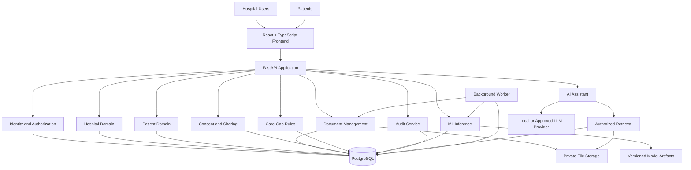

# CareGap-AI — System Architecture & Technical Design

**Document ID:** CGA-ARCH-002  
**Version:** 1.0  
**Status:** Proposed Architecture  
**Product:** CareGap-AI  
**Architecture Style:** Modular Monolith with Asynchronous Background Processing  
**Primary Modes:** Hospital Intelligence and Personal Health  
**Deployment Target:** Local Development First, Containerized Deployment Later

---

## 1. Purpose

This document defines the technical architecture of CareGap-AI, including its application layers, services, data flows, access boundaries, AI/ML components, infrastructure, and deployment strategy.

The architecture must support two distinct product experiences:

1. **Hospital Intelligence Mode:** Organization-scoped healthcare analytics, readmission-risk research, care-gap review, and operational workflows.
2. **Personal Health Mode:** Patient-owned records, document explanations, reminders, follow-up tracking, and consent-based information sharing.

Both modes may share common infrastructure, but they must not share unrestricted access to data.

The initial implementation is a research and portfolio prototype. Clinical deployment, real hospital integrations, and the use of real patient information require additional security, legal, operational, and clinical review.

## 2. Architectural Goals

The system must:

- Support both product modes without duplicating the entire backend.
- Separate business logic into maintainable modules.
- Enforce authentication and authorization on the server.
- Prevent unauthorized cross-organization and cross-patient access.
- Support reproducible machine-learning experiments.
- Keep clinical rules separate from probabilistic ML predictions.
- Ground AI-generated explanations in authorized evidence.
- Support local development with free or low-cost tools.
- Provide automated tests for security-critical workflows.
- Allow future deployment and integration without redesigning the complete application.

## 3. Architecture Style

### 3.1 Modular monolith

CareGap-AI will initially use a modular monolith rather than a collection of microservices.

A modular monolith means that the backend runs as one primary application while its internal modules have clearly defined responsibilities and interfaces.

This approach reduces deployment complexity, resource consumption, and development overhead while preserving separation between business domains.

### 3.2 Background processing

Tasks that are slow or resource-intensive should run outside the main request-response flow when necessary.

Examples include:

- Large CSV imports.
- Batch prediction jobs.
- Model training and evaluation.
- Document extraction and indexing.
- Long-running report generation.

The MVP may begin with a database-backed job table and a separate worker process. A dedicated queue such as Redis with a compatible task framework can be introduced if justified by workload.

Model training should run as a separate development or training command rather than automatically inside an API request.

### 3.3 Architectural boundaries

The system will have logical boundaries for:

- Identity and authorization.
- Hospital organizations and memberships.
- Patient profiles and personal records.
- Document management.
- Encounter and review workflows.
- Care-gap rules.
- ML prediction and evaluation.
- AI assistant orchestration.
- Consent and sharing.
- Notifications and reminders.
- Audit events and reporting.

These boundaries should remain explicit even though the initial application is deployed as a modular monolith.

## 4. High-Level Architecture



The diagram represents logical components, not separate independently deployed microservices. The frontend communicates with the backend API, and the backend invokes internal modules under the same authorization policy.

The AI assistant and background worker must not bypass the application's access-control rules.

## 5. Technology Stack

| Layer | Proposed technology | Responsibility |
|---|---|---|
| Frontend | React + TypeScript | User interface and client-side navigation |
| UI tooling | Vite | Frontend development and build |
| Backend | Python + FastAPI | HTTP API and application orchestration |
| Data validation | Pydantic | Request and response schemas |
| ORM and migrations | SQLAlchemy + Alembic | Database access and schema changes |
| Primary database | PostgreSQL | Application records and relational data |
| ML development | pandas + scikit-learn | Data preparation and model training |
| Explainability | SHAP, where appropriate | Model explanation |
| LLM integration | Provider-independent adapter | AI assistant model access |
| Local LLM runtime | Ollama, where feasible | Local model inference |
| Document extraction | Python PDF and image-processing libraries | Text extraction and OCR when needed |
| Backend testing | Pytest | Unit, integration, and authorization tests |
| Frontend testing | Vitest + React Testing Library | Component and workflow tests |
| Browser testing | Playwright, when needed | End-to-end workflows |
| Containerization | Docker Compose | Reproducible local environment |
| CI | GitHub Actions | Automated checks and test execution |

Final library versions should be selected and pinned during implementation. Optional technologies must not become mandatory unless they provide a measurable benefit.

## 6. Frontend Architecture

### 6.1 Application structure

The frontend will use one application shell with separate navigation and layouts for Hospital Mode and Patient Mode.

Proposed structure:

```text
frontend/
├── src/
│   ├── app/
│   │   ├── router.tsx
│   │   ├── providers.tsx
│   │   └── layouts/
│   │       ├── HospitalLayout.tsx
│   │       └── PatientLayout.tsx
│   ├── features/
│   │   ├── auth/
│   │   ├── hospital/
│   │   │   ├── dashboard/
│   │   │   ├── imports/
│   │   │   ├── encounters/
│   │   │   ├── predictions/
│   │   │   ├── care-gaps/
│   │   │   ├── review-tasks/
│   │   │   └── analytics/
│   │   ├── patient/
│   │   │   ├── dashboard/
│   │   │   ├── profile/
│   │   │   ├── documents/
│   │   │   ├── appointments/
│   │   │   ├── medications/
│   │   │   ├── care-plan/
│   │   │   ├── timeline/
│   │   │   └── sharing/
│   │   ├── ai-assistant/
│   │   └── settings/
│   ├── components/
│   ├── lib/
│   │   ├── api-client.ts
│   │   └── schemas.ts
│   ├── hooks/
│   ├── types/
│   └── main.tsx
├── package.json
└── vite.config.ts
```

### 6.2 Frontend responsibilities

The frontend is responsible for:

- Rendering mode-specific dashboards and navigation.
- Collecting user input and displaying validation feedback.
- Showing loading, success, and failure states.
- Displaying evidence and limitations alongside AI outputs.
- Providing document upload and sharing interfaces.
- Requesting protected data through the backend API.
- Hiding unavailable actions when permissions do not allow them.

The frontend is not responsible for enforcing security. Hiding a button or changing a route must never be treated as sufficient authorization.

### 6.3 Route separation

Proposed route groups:

```text
/login
/register

/hospital
/hospital/dashboard
/hospital/imports
/hospital/encounters
/hospital/encounters/:encounterId
/hospital/care-gaps
/hospital/reviews
/hospital/analytics
/hospital/model-evaluation
/hospital/settings

/patient
/patient/dashboard
/patient/profile
/patient/documents
/patient/documents/:documentId
/patient/appointments
/patient/medications
/patient/care-plan
/patient/timeline
/patient/sharing
/patient/settings
```

The backend must independently validate permissions for every protected resource referenced by these routes.

## 7. Backend Architecture

### 7.1 Proposed directory structure

```text
backend/
├── app/
│   ├── main.py
│   ├── core/
│   │   ├── config.py
│   │   ├── security.py
│   │   ├── permissions.py
│   │   ├── exceptions.py
│   │   └── logging.py
│   ├── api/
│   │   ├── dependencies.py
│   │   └── v1/
│   │       ├── router.py
│   │       ├── auth.py
│   │       ├── hospital.py
│   │       ├── patients.py
│   │       ├── documents.py
│   │       ├── sharing.py
│   │       ├── encounters.py
│   │       ├── predictions.py
│   │       ├── care_gaps.py
│   │       ├── reviews.py
│   │       ├── appointments.py
│   │       ├── medications.py
│   │       ├── copilot.py
│   │       ├── reports.py
│   │       └── audit.py
│   ├── modules/
│   │   ├── identity/
│   │   ├── organizations/
│   │   ├── patients/
│   │   ├── documents/
│   │   ├── consent/
│   │   ├── encounters/
│   │   ├── predictions/
│   │   ├── care_gaps/
│   │   ├── reviews/
│   │   ├── appointments/
│   │   ├── medications/
│   │   ├── ai_assistant/
│   │   ├── reporting/
│   │   └── audit/
│   ├── db/
│   │   ├── session.py
│   │   ├── base.py
│   │   └── models/
│   └── schemas/
├── tests/
│   ├── unit/
│   ├── integration/
│   └── security/
├── alembic/
├── alembic.ini
├── pyproject.toml
└── .env.example
```

### 7.2 Responsibilities by layer

**API layer**

- Accept and validate HTTP requests.
- Authenticate the caller.
- Invoke authorization dependencies.
- Call the appropriate application service.
- Return documented response schemas.

**Application/service layer**

- Orchestrate business workflows.
- Coordinate database operations and domain services.
- Apply transaction boundaries.
- Request audit events for sensitive operations.

**Domain layer**

- Implement business rules.
- Define role and ownership constraints.
- Evaluate care-gap rules.
- Validate sharing and consent transitions.
- Apply workflow-state transitions.

**Infrastructure layer**

- Implement database persistence.
- Store and retrieve private files.
- Load model artifacts.
- Connect to local or approved external LLM providers.
- Run background jobs.

The API layer should not contain all business logic. Domain rules must be reusable and independently testable.

## 8. Core Domain Modules

### 8.1 Identity and authorization

Manages user identities, sessions, organization memberships, role assignments, and access decisions.

It establishes the authenticated principal used by all other modules.

### 8.2 Hospital organizations

Manages organization settings, staff memberships, organization-scoped resources, and administrative permissions.

### 8.3 Patient records

Manages patient-owned profiles, history, personal health events, and other permitted personal records.

A patient identity and a hospital's internal encounter record are related concepts but must not be treated as interchangeable.

### 8.4 Document management

Manages document metadata, upload validation, private storage, text extraction, document processing status, and access checks.

Raw files should be stored separately from ordinary relational metadata when practical.

### 8.5 Consent and sharing

Manages explicit grants that allow a defined recipient to access selected patient information for a defined purpose and period, where applicable.

A sharing grant should specify:

- The patient or authorized grantor.
- The recipient.
- The selected resources or document scope.
- The permitted actions.
- The stated purpose.
- The creation and expiration details, where applicable.
- The revocation status.

### 8.6 Encounter and review workflows

Manages imported encounter data, risk-review worklists, review assignments, notes, and task status.

### 8.7 Care-gap engine

Evaluates versioned deterministic rules against available data.

It returns structured results containing the rule identifier, status, evidence references, evaluation time, and rule version.

### 8.8 ML service

Loads approved model artifacts and produces risk estimates for supported input records.

Training and evaluation remain separate from online inference.

### 8.9 AI assistant

Coordinates question validation, permission-aware context retrieval, model prompting, output validation, evidence references, and safe error handling.

### 8.10 Audit service

Records security-sensitive and business-critical events, including document sharing, permission changes, and relevant data access.

## 9. Authentication and Authorization Model

### 9.1 Authentication

The system must use a documented authentication mechanism. The initial implementation may use a secure session-based approach or a carefully implemented token-based approach.

Authentication credentials must be stored and transmitted securely. If browser cookies are used, cookie protections and CSRF controls must be implemented where appropriate. If bearer tokens are used, token storage, expiration, refresh, and revocation must be explicitly designed.

The frontend must not be the source of truth for identity.

### 9.2 Authorization

Authorization decisions will use the authenticated identity, requested resource, relationship to the resource, organizational membership, role, and applicable sharing grants.

Examples:

- A hospital quality analyst may view permitted aggregate analytics for their organization.
- A care reviewer may view and update encounters within their assigned scope.
- A patient may view and manage their own personal records.
- A recipient may view a patient document only when a valid sharing grant and the required permissions allow it.
- An organization administrator cannot automatically view every patient's private personal account merely because they administer a hospital workspace.

### 9.3 Tenant isolation

Hospital-owned operational data must be scoped to an organization.

Every organization-scoped query must apply the authorized organization scope. Resource identifiers supplied by the frontend must not be trusted as proof of access.

Where supported and correctly configured, PostgreSQL Row-Level Security may provide an additional defense-in-depth layer. It does not replace correct application authorization or tests.

### 9.4 Patient isolation

Patient-owned records must be scoped to the authenticated patient's identity or a valid, explicitly authorized delegated-access relationship.

Tests must verify that changing a document, appointment, patient, or sharing identifier cannot expose another user's data.

## 10. Data Architecture

PostgreSQL will be the primary source of truth for structured application data.

The initial schema is expected to include:

### Identity and organizations

- `users`
- `organizations`
- `organization_memberships`
- `sessions` or the persistence required by the selected authentication mechanism

### Patient domain

- `patient_profiles`
- `health_events`
- `medical_documents`
- `document_extractions`
- `appointments`
- `medication_entries`
- `care_plan_items`
- `sharing_grants`

### Hospital domain

- `import_jobs`
- `encounters`
- `predictions`
- `care_gap_results`
- `review_tasks`
- `review_notes`
- `care_gap_rules`
- `model_versions`

### AI and governance

- `copilot_runs`
- `audit_events`
- `background_jobs`

This is a logical inventory, not the final database schema. Relationships, constraints, indexes, retention rules, and field-level privacy decisions will be defined in Document 03.

### 10.1 Data ownership

The application must distinguish between:

- Patient-owned information.
- Hospital organization-owned operational information.
- Imported source records.
- Derived model predictions.
- AI-generated summaries and explanations.
- Audit and security metadata.

Derived information must retain sufficient provenance to identify its source records, model or rule version, and generation time where appropriate.

### 10.2 Document storage

Documents should be stored in private local storage during development or private object storage in a later deployment.

PostgreSQL stores document metadata and a storage reference, not necessarily the complete file contents.

A storage reference must not function as a public authorization bypass. Document retrieval must pass through a permission-checked service or an appropriately scoped, short-lived access mechanism.

### 10.3 Database migrations

Schema changes must use version-controlled migrations. Manual production schema edits should not be the normal deployment process.

Development and testing should use separate databases or isolated database schemas as appropriate.

## 11. AI/ML Architecture

### 11.1 Training pipeline

The training pipeline runs independently of the interactive application.

Expected stages:

1. Load the approved dataset.
2. Validate schema and target definitions.
3. Remove or exclude prohibited identifiers.
4. Check data quality and missingness.
5. Split data according to the evaluation design.
6. Fit preprocessing steps on training data only.
7. Train baseline and candidate models.
8. Evaluate predictive performance and calibration.
9. Examine subgroup performance and potential bias where data permits.
10. Save approved model artifacts and evaluation reports.
11. Record model version, dataset provenance, configuration, and limitations.

The exact dataset, target definition, prediction horizon, and split strategy must be documented before model development.

### 11.2 Inference pipeline

```text
Authorized Encounter
        |
        v
Input Validation
        |
        v
Feature Preparation
        |
        v
Versioned ML Model
        |
        v
Risk Estimate + Explanation
        |
        v
Persist Prediction Metadata
        |
        v
Authorized Hospital UI
```

The inference service must validate input features and reject unsupported or malformed inputs.

A prediction must include the model version and generation timestamp. It must not be interpreted outside the population and setting for which the model was evaluated.

### 11.3 Care-gap rules

Care-gap rules operate separately from the ML model.

They evaluate whether defined information is present, missing, conflicting, or otherwise relevant according to a documented rule.

The rule engine must not automatically convert a missing field into a confirmed failure of care.

### 11.4 AI assistant architecture

The AI assistant uses retrieval-augmented generation (RAG) where appropriate.

Expected stages:

1. Authenticate the caller.
2. Determine the permitted data scope.
3. Retrieve relevant authorized records or document passages.
4. Remove unrelated and unnecessary information.
5. Construct a bounded prompt with source references.
6. Invoke the configured LLM.
7. Validate the response structure and evidence references.
8. Return the answer with limitations and supporting evidence.
9. Record appropriate metadata for auditing and debugging.

Authorization must be applied before retrieved information enters the model context. Filtering a completed answer is not an acceptable substitute.

### 11.5 LLM provider adapter

The AI assistant should depend on an internal provider interface rather than a single vendor-specific implementation.

This allows local inference through Ollama where hardware and model capabilities permit, with an alternative provider added later if justified.

The application must handle unavailable models, timeouts, invalid outputs, and inference errors gracefully.

Sending personal or clinical documents to an external model provider requires a deliberate privacy and data-handling decision; it must not happen implicitly.

## 12. Core Data Flows

### 12.1 Hospital encounter review

1. An authorized hospital user uploads a supported data file.
2. The import service validates the file and creates an import job.
3. Valid records are normalized and stored within the authorized organization scope.
4. The ML service generates a research-oriented risk estimate where supported.
5. The care-gap engine evaluates applicable rules.
6. A review task may be created according to configured workflow rules.
7. An authorized reviewer examines the evidence and records a decision.
8. Relevant events are audited.

### 12.2 Patient document explanation

1. A patient signs in.
2. The patient uploads a document.
3. The document service validates the file and stores it privately.
4. Text extraction runs, with OCR where required and supported.
5. The patient requests an explanation.
6. The retrieval layer loads only the permitted document content.
7. The AI assistant generates a bounded, evidence-grounded explanation.
8. The interface displays the explanation, source references, and relevant limitations.

If extraction fails or the document is unreadable, the application must report the failure rather than invent a summary.

### 12.3 Patient-to-provider sharing

1. The patient selects specific information.
2. The patient identifies the intended recipient and scope.
3. The system explains what will be accessible.
4. The patient confirms the sharing action.
5. The backend validates ownership and creates a sharing grant.
6. The recipient authenticates and requests the shared resource.
7. The backend checks the grant, recipient, scope, status, and any applicable expiration.
8. The access event is audited.
9. The patient can review and revoke the grant where supported.

Revocation must invalidate future access through the application's sharing mechanism.

## 13. API Architecture

The backend will expose a versioned REST API under `/api/v1`.

Proposed route groups:

```text
/api/v1/auth/*
/api/v1/users/*
/api/v1/organizations/*
/api/v1/hospital/*
/api/v1/encounters/*
/api/v1/imports/*
/api/v1/predictions/*
/api/v1/care-gaps/*
/api/v1/review-tasks/*
/api/v1/patients/me/*
/api/v1/patients/me/documents/*
/api/v1/patients/me/appointments/*
/api/v1/patients/me/medications/*
/api/v1/patients/me/care-plan/*
/api/v1/patients/me/sharing/*
/api/v1/copilot/*
/api/v1/reports/*
/api/v1/audit-events/*
/health
/ready
```

These routes are proposed contracts, not implemented endpoints. Exact methods, request schemas, response schemas, pagination, error codes, and permissions will be defined in Document 04.

### 13.1 API principles

- Validate all incoming data.
- Use explicit request and response schemas.
- Return consistent error formats.
- Paginate potentially large collections.
- Apply authorization to each resource access.
- Avoid returning unnecessary sensitive fields.
- Use appropriate idempotency and duplicate-handling strategies for relevant operations.
- Avoid exposing stack traces or secrets in production errors.
- Rate-limit sensitive or resource-intensive operations where appropriate.

## 14. Background Jobs

A separate worker process may handle:

- Batch CSV validation and imports.
- Batch ML inference.
- Document text extraction and OCR.
- Document indexing.
- Scheduled reminder processing.
- Report generation.
- Model evaluation runs.

Background jobs must carry explicit, validated resource scope and must re-check permissions where user-initiated access is involved.

Jobs should support status tracking, retry policies, failure reporting, and safe duplicate handling.

For the initial MVP, the job system should remain simple. A separate queue technology can be introduced when the workload requires it.

## 15. Security Architecture

Security controls include:

- Secure authentication and session handling.
- Server-side authorization for all protected resources.
- Hospital tenant isolation.
- Patient ownership enforcement.
- Explicit and auditable sharing grants.
- Input validation and bounded uploads.
- Private document storage.
- Secrets stored outside source control.
- Dependency and vulnerability checks.
- Safe handling of AI prompts and retrieved documents.
- Audit logging for sensitive operations.
- Tests for horizontal privilege escalation and unauthorized access.
- Data minimization and documented retention decisions.

AI-generated content and uploaded documents must be treated as untrusted input. Prompt injection inside a document must not be allowed to override authorization rules or trigger privileged actions.

A prototype must not claim compliance with a healthcare regulation solely because these controls are planned or partially implemented.

## 16. Error Handling and Observability

The application should use structured logs, consistent error responses, and correlation identifiers for troubleshooting.

Expected failure categories include:

- Authentication failure.
- Authorization denial.
- Invalid input.
- File validation failure.
- Database unavailability.
- Background job failure.
- Model artifact unavailable.
- ML inference error.
- LLM timeout or invalid output.
- Document extraction failure.
- Expired or revoked sharing grant.

Logs must not contain passwords, access tokens, or unnecessary document contents.

The application should expose a lightweight health endpoint and a readiness endpoint that checks the dependencies necessary for serving requests.

## 17. Testing Architecture

### Unit tests

Test isolated business logic, care-gap rules, validation, data transformations, and permission decisions.

### Integration tests

Test database operations, API behavior, document metadata, sharing workflows, and ML inference interfaces.

### Security tests

Verify that:

- One hospital organization cannot access another organization's encounters.
- One patient cannot access another patient's records or documents.
- A revoked sharing grant prevents future access.
- An unauthorized recipient cannot retrieve a shared resource.
- A frontend-supplied role or organization identifier cannot grant permissions.
- The AI retrieval layer cannot include unauthorized records.
- Invalid files and malformed requests are rejected safely.

### ML tests

Test preprocessing consistency, model artifact loading, prediction schema, reproducibility, data leakage controls, and metric reporting.

### End-to-end tests

Test complete user journeys for hospital review and patient document management, including denied-access scenarios.

## 18. Deployment Architecture

### 18.1 Local development

The initial environment should use:

- A React development server.
- A FastAPI development server.
- PostgreSQL in Docker or an appropriate local installation.
- Private local document storage.
- Local ML artifacts.
- Optional Ollama inference.
- A separate worker process when background jobs are introduced.

### 18.2 Containerization

Docker Compose may coordinate the backend, database, and supporting services.

The frontend may run through its development server initially and be built into static assets for a later deployment.

Persistent database and document-storage volumes must be configured for local development.

### 18.3 Configuration

Configuration should be provided through environment variables and a validated settings module.

The repository should include `.env.example` with placeholder values only. Real secrets must never be committed.

### 18.4 Production readiness

Before any real-world deployment, the system requires additional review of:

- Hosting and network security.
- Encryption and key management.
- Authentication hardening.
- Backup and recovery.
- Monitoring and incident response.
- Privacy and retention obligations.
- Consent and access procedures.
- Clinical validation and intended-use boundaries.
- Applicable legal and regulatory requirements.

## 19. Scalability and Future Evolution

The initial architecture prioritizes correctness and maintainability over premature scaling.

Potential future improvements include:

- A dedicated queue and worker infrastructure.
- Private object storage for documents.
- Search indexing for larger document collections.
- Dedicated model-serving infrastructure.
- External identity-provider integration.
- Hospital EHR integration through appropriate standards.
- Advanced monitoring for model drift and data quality.
- Separate deployable services if operational scale justifies them.

These changes should be driven by measured requirements rather than introduced solely to make the architecture appear more complex.

## 20. Key Architecture Decisions

| Decision | Initial choice | Rationale |
|---|---|---|
| Application structure | Modular monolith | Simpler development and deployment |
| API | FastAPI REST API | Strong Python ecosystem and validation support |
| Frontend | React + TypeScript | Maintainable interactive interface |
| Database | PostgreSQL | Relational integrity and mature access-control options |
| ML execution | Separate training and inference paths | Reproducibility and operational safety |
| Care-gap detection | Versioned deterministic rules | Traceable, testable decisions |
| AI assistant | Evidence-grounded RAG | More transparent answers and controlled context |
| File storage | Private storage separate from metadata | Better separation and access control |
| Job execution | Separate worker when needed | Avoid blocking interactive requests |
| Hospital isolation | Organization-scoped authorization | Prevent cross-tenant access |
| Patient privacy | Ownership and explicit sharing grants | Prevent unintended access |
| Development deployment | Docker Compose where useful | Reproducible local environment |

## 21. Implementation Order

Architecture implementation should follow these stages:

1. Create the repository structure and environment configuration.
2. Set up the frontend, backend, and database.
3. Add schema migrations and health endpoints.
4. Implement authentication and authorization foundations.
5. Define hospital organization and patient ownership boundaries.
6. Implement private document metadata and storage.
7. Add consent and sharing workflows.
8. Implement hospital encounter import and review workflows.
9. Build the offline ML pipeline and evaluation reports.
10. Add the care-gap rule engine.
11. Add the evidence-grounded AI assistant.
12. Build both user experiences.
13. Add comprehensive authorization, integration, and end-to-end tests.
14. Document local setup and prepare the portfolio demonstration.

The implementation order may change where dependencies require it, but authorization, ownership, and data boundaries must be established before sensitive workflows are exposed.

## 22. Open Design Decisions

The following decisions must be finalized in the relevant technical documents:

- Exact authentication strategy and session lifecycle.
- Final database relationships and constraints.
- Whether document processing uses local OCR, an external service, or both.
- Which LLM and embedding models can run acceptably on the available hardware.
- The initial reminder delivery mechanism.
- The model's exact target definition, dataset, and evaluation protocol.
- Which resources may be shared with a provider and under which permissions.
- Data retention and deletion behavior.
- Whether PostgreSQL Row-Level Security is appropriate for the chosen implementation.

Each decision should be recorded with its rationale and relevant trade-offs.

## 23. Definition of Architecture Completion

The architecture is sufficiently defined for initial implementation when:

- Major modules and their responsibilities are documented.
- Hospital and patient data boundaries are explicit.
- Authentication and authorization requirements are testable.
- The primary database entities are identified.
- API route groups are established.
- ML training and inference are separated.
- AI retrieval respects authorization boundaries.
- Document storage and sharing workflows are defined.
- Local development and deployment approaches are documented.
- Critical security tests have been planned.

---

**End of Document 02 — System Architecture & Technical Design**
