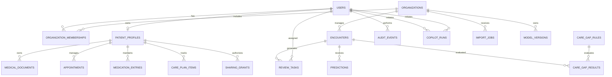

# CareGap-AI — Database Design

**Document ID:** CGA-DB-003  
**Version:** 1.0  
**Status:** Proposed Schema  
**Database:** PostgreSQL  
**ORM:** SQLAlchemy  
**Migrations:** Alembic

---

## 1. Purpose

This document defines the proposed relational database architecture for CareGap-AI.

The database must support:

- User identity and authentication.
- Hospital organizations and staff memberships.
- Patient-owned health information.
- Private medical document storage.
- Explicit patient-to-provider sharing.
- Hospital encounters and readmission-risk predictions.
- Care-gap detection and review workflows.
- Appointments, medication records, and personal care plans.
- AI assistant execution metadata.
- Audit logging and background jobs.

The schema must enforce clear ownership boundaries and preserve the provenance of imported, patient-entered, model-generated, and AI-generated information.

This is a proposed logical design. Exact column types, constraints, indexes, and migrations will be finalized during implementation.

## 2. Database Design Principles

### 2.1 Relational integrity

Use primary keys, foreign keys, unique constraints, check constraints, and transactions wherever appropriate.

### 2.2 Explicit ownership

Every patient-owned record must have an unambiguous owner. Every hospital operational record must have an explicit organization scope.

### 2.3 Least privilege

A valid database identifier must never be treated as proof that a user is authorized to access the associated record.

### 2.4 Data provenance

Derived information should retain references to its source records, rule version, model version, or document extraction when relevant.

### 2.5 Minimal sensitive data

Store only information needed for documented product features. Avoid collecting unnecessary direct identifiers.

### 2.6 Separation of concerns

Hospital encounters, patient profiles, uploaded documents, model predictions, and AI-generated summaries represent different concepts and must not be merged into a single generic table.

### 2.7 Schema evolution

All schema changes must be version-controlled through Alembic migrations.

## 3. Database Technology

The initial database is PostgreSQL.

Recommended implementation components:

- PostgreSQL for structured records.
- SQLAlchemy for database access.
- Alembic for schema migrations.
- Pydantic for API input and output validation.
- Pytest for database and authorization tests.

The application should use transactions for workflows that modify multiple related records.

## 4. High-Level Entity Relationships



The diagram represents the primary relationships. Supporting tables and additional foreign keys may be introduced where required.

A hospital encounter and a patient profile are not automatically linked merely because their records contain similar demographic information. Any linkage must be explicitly authorized and designed.

## 5. Naming and Common Fields

Use consistent naming conventions:

- Tables: plural snake_case, such as `patient_profiles`.
- Columns: snake_case, such as `created_at`.
- Primary keys: `id`.
- Foreign keys: descriptive names ending in `_id`.
- Timestamps: timezone-aware timestamps.
- Status fields: constrained values or validated enumerations.

Common fields, where appropriate:

| Field | Purpose |
|---|---|
| `id` | Unique primary key |
| `created_at` | Record creation time |
| `updated_at` | Last modification time |
| `created_by_user_id` | User responsible for creating a record, where applicable |

Do not add every common field mechanically to every table. Audit records, immutable model artifacts, and append-only event records may require different behavior.

Use UUID identifiers for externally referenced records where appropriate. UUIDs reduce easy enumeration but do not replace authorization.

## 6. Identity and Organization Tables

### 6.1 `users`

Stores the application's user identity and basic account metadata.

Proposed fields:

- `id`
- `email`
- `password_hash`, if passwords are managed locally
- `display_name`
- `account_status`
- `email_verified_at`
- `created_at`
- `updated_at`

Constraints:

- Email must be unique under the chosen normalization strategy.
- Passwords must never be stored in plaintext.
- Authentication secrets and tokens must not be stored as ordinary profile fields.
- Disabled accounts must not continue to access protected resources.

If an external identity provider is selected, authentication-specific fields should reflect that provider instead.

### 6.2 `organizations`

Represents a hospital or healthcare organization using Hospital Mode.

Proposed fields:

- `id`
- `name`
- `organization_status`
- `created_at`
- `updated_at`

An organization is a security boundary for its hospital operational data.

### 6.3 `organization_memberships`

Connects users to hospital organizations.

Proposed fields:

- `id`
- `organization_id`
- `user_id`
- `role`
- `membership_status`
- `created_at`
- `updated_at`

Initial roles:

- `organization_admin`
- `quality_analyst`
- `care_reviewer`
- `read_only_viewer`

Constraints:

- A user should not have duplicate active memberships for the same organization unless a future design explicitly supports them.
- Roles must come from an approved set.
- Membership status must be checked during authorization.

A user may have an organization membership without having permission to view any particular patient's personal account.

### 6.4 `sessions`

Required if the chosen authentication approach stores application-managed sessions in the database.

Possible fields:

- `id`
- `user_id`
- `session_token_hash`
- `expires_at`
- `revoked_at`
- `created_at`

Store only an appropriately protected session-token representation. Do not store reusable raw session tokens.

If authentication is implemented through a different mechanism, use its appropriate session and revocation design instead.

## 7. Patient Tables

### 7.1 `patient_profiles`

Stores patient-owned profile information.

Proposed fields:

- `id`
- `user_id`
- `date_of_birth`, optional
- `preferred_name`, optional
- `preferred_language`, optional
- `emergency_contact_details`, optional and subject to a separate privacy decision
- `created_at`
- `updated_at`

Constraints:

- `user_id` must uniquely identify the owner for the initial one-account-to-one-profile design.
- Optional fields must remain optional unless a feature genuinely requires them.
- Sensitive profile information must not appear in unrestricted logs or analytics.

A patient profile is not automatically a hospital medical record.

### 7.2 `health_events`

Stores patient-entered personal health timeline events.

Proposed fields:

- `id`
- `patient_profile_id`
- `event_type`
- `title`
- `description`, optional
- `event_date`, optional
- `source_type`
- `source_reference`, optional
- `created_at`
- `updated_at`

Example event types include a patient-entered appointment, an uploaded report, or a personal follow-up milestone.

The interface must distinguish self-reported events from verified clinical records.

### 7.3 `medical_documents`

Stores metadata for private patient documents.

Proposed fields:

- `id`
- `patient_profile_id`
- `document_type`
- `original_filename`
- `storage_key`
- `mime_type`
- `file_size_bytes`
- `document_date`, optional
- `upload_status`
- `created_at`
- `updated_at`

Constraints:

- The storage key must not expose a public file location.
- File size and supported content types must be validated.
- The storage reference must be unique where required.
- A document must remain inaccessible unless the requester is authorized to retrieve it.

Document content should be stored in private file storage rather than directly in the database for the initial design.

### 7.4 `document_extractions`

Stores extracted text and processing metadata for a document.

Proposed fields:

- `id`
- `document_id`
- `extraction_version`
- `processing_status`
- `extracted_text_reference` or protected extracted text
- `extraction_method`
- `confidence_metadata`, optional
- `error_code`, optional
- `processed_at`
- `created_at`

Extracted text can contain sensitive information. Its storage and retrieval must use the same privacy protections as the source document.

Where practical, keep large extracted text or search indexes in separate protected storage. Preserve enough source-location information to support evidence references.

### 7.5 `appointments`

Stores patient-managed appointments and reminders.

Proposed fields:

- `id`
- `patient_profile_id`
- `title`
- `provider_name`, optional
- `scheduled_at`
- `location`, optional
- `notes`, optional
- `status`
- `reminder_enabled`
- `created_at`
- `updated_at`

The application must not infer that an appointment occurred merely because its scheduled time has passed.

### 7.6 `medication_entries`

Stores patient-maintained medication information.

Proposed fields:

- `id`
- `patient_profile_id`
- `medication_name`
- `dosage_text`, optional
- `instructions_text`, optional
- `start_date`, optional
- `end_date`, optional
- `source_type`
- `status`
- `created_at`
- `updated_at`

This table represents recorded information, not a prescribing engine.

The system must distinguish patient-entered details from information transcribed from a document. Any uncertain extraction must be presented for confirmation rather than silently converted into authoritative instructions.

### 7.7 `care_plan_items`

Stores personal follow-up tasks and care-plan checklist items.

Proposed fields:

- `id`
- `patient_profile_id`
- `title`
- `description`, optional
- `due_at`, optional
- `status`
- `source_type`
- `source_reference`, optional
- `completed_at`, optional
- `created_at`
- `updated_at`

Initial statuses:

- `pending`
- `completed`
- `cancelled`
- `needs_confirmation`

A missing task record does not establish that a clinical action was missed.

## 8. Patient Consent and Sharing Tables

### 8.1 `sharing_grants`

Represents explicit permission to share selected information.

Proposed fields:

- `id`
- `patient_profile_id`
- `recipient_user_id`
- `recipient_organization_id`, optional
- `resource_type`
- `resource_id`, where applicable
- `purpose`
- `permission_scope`
- `status`
- `granted_at`
- `expires_at`, optional
- `revoked_at`, optional
- `created_at`
- `updated_at`

Initial statuses:

- `active`
- `revoked`
- `expired`

Design requirements:

- The grant must identify the patient and recipient.
- Access must be limited to the intended resource or explicitly defined scope.
- The backend must validate that the resource belongs to the patient.
- A grant must not automatically authorize access to unrelated documents or the patient's entire account.
- Revocation must prevent future access through the application.
- Expiration must be checked when the resource is requested, not merely by the frontend.

Avoid an ambiguous polymorphic reference without validation. If the chosen ORM and schema require stronger referential integrity, use separate resource-specific grant tables or a normalized shared-resource model.

### 8.2 Consent history

Where legally or operationally necessary, consent changes should be recorded as immutable events or represented through an appropriate versioned history.

The audit record should identify the action and its timestamp without unnecessarily duplicating sensitive document content.

## 9. Hospital Data Tables

### 9.1 `import_jobs`

Tracks hospital data imports.

Proposed fields:

- `id`
- `organization_id`
- `created_by_user_id`
- `source_filename`
- `status`
- `total_rows`
- `valid_rows`
- `invalid_rows`
- `error_summary`
- `started_at`
- `completed_at`
- `created_at`

Import processing must be organization-scoped and must not expose records to another organization.

### 9.2 `encounters`

Represents an imported hospital encounter.

Proposed fields:

- `id`
- `organization_id`
- `import_job_id`, optional
- `source_record_id`, where permitted
- `admission_date`, optional
- `discharge_date`, optional
- `encounter_type`, optional
- `normalized_features`
- `data_quality_status`
- `created_at`
- `updated_at`

Direct patient identifiers should not be imported into the ML workflow unless necessary and authorized.

The schema for encounter features must be based on the selected dataset and documented prediction target. A public dataset identifier should not be assumed to be a real patient identity.

If a future integration needs to associate a hospital encounter with a patient account, that association requires a separately designed and authorized linkage process.

### 9.3 `predictions`

Stores readmission-risk model outputs.

Proposed fields:

- `id`
- `organization_id`
- `encounter_id`
- `model_version_id`
- `prediction_value`
- `prediction_target`
- `prediction_horizon`
- `explanation_reference`, optional
- `input_quality_status`
- `generated_at`
- `created_at`

Constraints:

- The encounter and prediction must belong to the same organization.
- The model version must be identifiable.
- Prediction values must conform to the selected model output type.
- The target and horizon must be explicit.

Predictions must not be presented as definitive diagnoses or guarantees.

### 9.4 `care_gap_rules`

Stores versioned care-gap rules.

Proposed fields:

- `id`
- `rule_key`
- `version`
- `name`
- `description`
- `rule_definition`
- `status`
- `created_at`
- `updated_at`

Constraints:

- The combination of `rule_key` and `version` must be unique.
- Rule changes must be traceable.
- Only approved rule versions should be used in a given evaluation workflow.

Rule definitions must use a controlled, validated format rather than executing arbitrary code stored in the database.

### 9.5 `care_gap_results`

Stores care-gap evaluation outcomes.

Proposed fields:

- `id`
- `organization_id`
- `encounter_id`
- `care_gap_rule_id`
- `status`
- `evidence_reference`
- `evaluation_details`, optional
- `evaluated_at`
- `created_at`

Initial statuses:

- `documented`
- `not_documented`
- `conflicting`
- `unknown`
- `not_applicable`

Results must reference the rule version and supporting evidence. They must distinguish absence of documentation from evidence that a clinical action was missed.

### 9.6 `review_tasks`

Tracks hospital review work.

Proposed fields:

- `id`
- `organization_id`
- `encounter_id`
- `assigned_to_user_id`, optional
- `task_type`
- `status`
- `priority`
- `due_at`, optional
- `created_by_user_id`
- `created_at`
- `updated_at`
- `completed_at`, optional

The backend must verify that the assigned user has the required active membership and permissions within the same organization.

### 9.7 `review_notes`

Stores notes created during an authorized hospital review.

Proposed fields:

- `id`
- `organization_id`
- `review_task_id`
- `author_user_id`
- `note_text`
- `created_at`
- `updated_at`

Notes may contain sensitive information and must be protected accordingly.

Edits to clinically significant review notes may require a version history or append-only correction workflow, depending on the intended use.

### 9.8 `model_versions`

Tracks available ML model artifacts.

Proposed fields:

- `id`
- `organization_id`, optional for shared research models
- `model_name`
- `version`
- `artifact_reference`
- `training_dataset_reference`
- `target_definition`
- `evaluation_summary`
- `status`
- `created_at`

The artifact reference should point to a controlled storage location. Model files must not be loaded from arbitrary user-supplied paths.

Model metadata must identify the training configuration, intended population, and evaluation limitations where available.

## 10. AI and Audit Tables

### 10.1 `copilot_runs`

Stores metadata about AI assistant executions.

Proposed fields:

- `id`
- `user_id`
- `mode`
- `organization_id`, optional
- `patient_profile_id`, optional
- `request_type`
- `model_provider`
- `model_name`
- `source_references`
- `status`
- `started_at`
- `completed_at`
- `error_code`, optional

Store only the metadata necessary for auditability and debugging. Raw prompts and responses may contain sensitive information and should not be retained by default unless there is a documented need, appropriate authorization, and suitable protection.

Source references must not themselves grant access to a record.

### 10.2 `audit_events`

Records important security and business events.

Proposed fields:

- `id`
- `actor_user_id`, optional for system-generated events
- `organization_id`, optional
- `event_type`
- `resource_type`
- `resource_id`, optional
- `action_result`
- `correlation_id`, optional
- `metadata`
- `created_at`

Examples:

- Successful or failed authorization checks where useful.
- Organization membership changes.
- Document sharing and revocation.
- Sensitive document access.
- Data imports.
- Model version changes.
- Review task completion.
- Administrative changes.

Audit events should be append-only to the extent practical. Do not include passwords, session tokens, or unnecessary medical content in audit metadata.

### 10.3 `background_jobs`

Tracks asynchronous tasks.

Proposed fields:

- `id`
- `job_type`
- `status`
- `resource_scope`
- `attempt_count`
- `max_attempts`
- `scheduled_at`
- `started_at`
- `completed_at`
- `error_code`, optional
- `created_at`

Job payloads must be validated and must not become a way to bypass authorization. Use idempotency controls for jobs that may be retried.

## 11. Key Relationship Constraints

The implementation must enforce these invariants:

1. A patient profile belongs to the intended user.
2. A patient document belongs to one patient profile.
3. Patient-owned appointments, medication entries, and care-plan items belong to their owner.
4. A sharing grant can only authorize resources belonging to the patient who granted access.
5. An encounter belongs to one organization.
6. A prediction references an encounter and model version with compatible organization scope.
7. A care-gap result references the encounter and rule used to produce it.
8. A review task belongs to an encounter within the same organization.
9. An assigned reviewer has an active membership and sufficient permissions.
10. A hospital user cannot access a patient-owned document without a valid authorization path.
11. An AI run cannot access resources outside its authorized context.
12. Audit records must not accidentally expose secrets or unnecessary sensitive data.

Where practical, enforce consistency using composite foreign keys, unique constraints, transactions, and database constraints in addition to application-level checks.

## 12. Authorization Query Patterns

### 12.1 Patient-owned resource

A patient-owned document lookup must constrain both the requested document and the authenticated patient's ownership.

Conceptually:

```sql
SELECT d.*
FROM medical_documents AS d
JOIN patient_profiles AS p
  ON p.id = d.patient_profile_id
WHERE d.id = :document_id
  AND p.user_id = :authenticated_user_id;
```

This is an illustrative ownership query. A provider's shared access must use a separately validated authorization path.

### 12.2 Organization-scoped encounter

An encounter query must constrain the encounter to the authorized organization.

Conceptually:

```sql
SELECT e.*
FROM encounters AS e
WHERE e.id = :encounter_id
  AND e.organization_id = :authorized_organization_id;
```

The authorized organization identifier must come from a validated server-side authorization decision, not merely from an untrusted request parameter.

### 12.3 Shared document access

A shared-document request must verify:

- The requesting user is the intended recipient.
- The grant is active and not expired.
- The requested resource matches the grant's scope.
- The grant was created by an authorized owner.
- The requested action is permitted.
- Any additional organization or delegated-access conditions are satisfied.

All these checks must occur on the backend.

## 13. Database Indexing

Initial indexes should support common access patterns.

Potential indexes include:

- `users(email)` — unique.
- `organization_memberships(user_id, organization_id)` — unique as appropriate.
- `organization_memberships(organization_id, membership_status)`.
- `patient_profiles(user_id)` — unique.
- `medical_documents(patient_profile_id, created_at)`.
- `appointments(patient_profile_id, scheduled_at)`.
- `care_plan_items(patient_profile_id, status)`.
- `sharing_grants(recipient_user_id, status)`.
- `sharing_grants(patient_profile_id, status)`.
- `encounters(organization_id, admission_date)`.
- `predictions(organization_id, encounter_id, generated_at)`.
- `care_gap_results(organization_id, encounter_id, status)`.
- `review_tasks(organization_id, status, assigned_to_user_id)`.
- `audit_events(organization_id, created_at)`.
- `background_jobs(status, scheduled_at)`.

These are starting recommendations. Actual indexes should be verified against queries and representative data.

## 14. Data Retention and Deletion

Retention requirements must be decided before production use.

The application should define behavior for:

- Account deactivation.
- Patient document deletion.
- Expired sharing grants.
- Removal or correction of patient-entered records.
- Imported dataset cleanup.
- Audit-log retention.
- Model artifact retention.
- Background job cleanup.

Deleting a patient account may affect records that have separate legal, operational, or audit retention requirements. The implementation must define these relationships explicitly rather than deleting related records indiscriminately.

Where deletion is appropriate, it should cover private file storage, extracted text, indexes, and other derived copies, subject to applicable retention requirements.

## 15. Development and Test Data

Development must use synthetic patient profiles, fictional documents, and synthetic hospital encounters.

Public datasets used for offline model training must be handled separately from application accounts and patient-owned records.

Tests must include:

- Two different hospital organizations.
- Multiple users with different hospital roles.
- Multiple independent patient accounts.
- Shared and unshared documents.
- Active, revoked, and expired sharing grants.
- Missing and conflicting clinical fields.
- Valid and invalid encounter records.

These fixtures are necessary to test isolation and prevent accidental data leakage.

## 16. Database Migration Strategy

Use Alembic for schema versioning.

Recommended process:

1. Define SQLAlchemy models.
2. Generate an initial migration.
3. Review the generated migration manually.
4. Apply it to a development database.
5. Run schema and relationship tests.
6. Update models and create new migrations as requirements evolve.
7. Test migrations against a clean database before release.

Avoid relying exclusively on automatic schema creation during application startup.

## 17. Initial Implementation Order

Implement the database in this order:

1. Users and authentication persistence.
2. Organizations and memberships.
3. Patient profiles and ownership constraints.
4. Medical documents and private storage metadata.
5. Sharing grants and authorization tests.
6. Appointments, medication entries, and care-plan items.
7. Import jobs and encounters.
8. Model versions and predictions.
9. Care-gap rules and results.
10. Review tasks and notes.
11. AI execution metadata.
12. Audit events and background jobs.

This order prioritizes the security foundations needed by both product modes.

## 18. Definition of Completion

The database design is ready for implementation when:

- Every core entity has a defined purpose.
- Patient ownership is explicit.
- Hospital organization scope is explicit.
- Sharing grants are narrow and auditable.
- Major relationships and constraints are documented.
- Sensitive records have defined access boundaries.
- ML predictions and care-gap results preserve provenance.
- Migration and testing procedures are defined.
- Retention and deletion decisions are identified for further review.

---

**End of Document 03 — Database Design**
